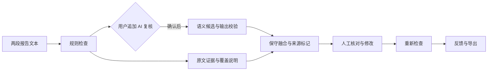

# 报告文本一致性检查与评测工作台

基于规则与可选大模型复核的影像报告文本检查工具。对比“影像所见”与“诊断意见”，定位有限范围内的侧别、尺寸及肯否表达差异，并提供原文证据、人工复检、反馈与结果导出。

当前版本：**v0.8** · 规则引擎 **v1.3.1** · 结果融合 **v0.2**。支持本机运行，全部开发案例为合成文本。项目仅检查文本一致性，不作医学诊断，不自动修改或签发报告，尚未开展医院部署或临床效果验证。

## 功能

| 能力 | 支持范围 | 处理方式 |
| --- | --- | --- |
| 侧别与部位检查 | 有限词表内可唯一配对的明确对象 | 提示左右等表达不一致，展示两段原文 |
| 尺寸与单位检查 | 同侧、同部位、同对象的普通精确单值，支持 mm/cm/毫米/厘米 | 换算单位后比较；范围、近似、多径和多对象等情况说明跳过原因 |
| 肯定与否定检查 | 同一明确对象的存在/否定表达 | 标记冲突；不将不确定、历史或复杂否定直接归为肯否 |
| AI 语义复核 | 用户主动追加的候选检查 | 校验结构、类别和原文证据后融合；新增候选标记类别待核对 |
| 人工复检与反馈 | 查看证据、修改文本、重新检查 | 保留历史输入和结果，区分人工反馈与文本修改 |
| 会话管理与导出 | 案例记录、分类筛选、结果/会话 JSON 导出 | 同一会话最多保留 12 次检查；刷新清除会话数据 |

界面包括检查工作台、案例与记录、复核管理、评测与说明、产品过程五个入口。

## 工作流与架构



规则先返回确定性检查结果，AI 作为独立的可选步骤。模型候选必须包含能在两段输入中唯一定位的原文证据；严格满足同类别和同证据区间的候选才与规则项合并。AI 失败或无候选不会删除规则提示。对未与规则严格合并的新增 AI 候选，统一显示“文本不一致候选，类别待核对”，并保留模型原类别。

修改输入后需要重新检查。前后结果仅在同一任务、相同规则版本、检查范围和 AI 完成模式下比较。没有提示、没有可比较内容、AI 未执行和执行失败分别显示。

## 快速开始

验证环境：macOS、Python 3.14、Chrome。应用使用 Python 标准库及原生 HTML/CSS/JavaScript，无需安装本地模型。服务使用 `fcntl` 管理本机请求额度锁，Windows 及其他 Python 版本尚未验证。

```bash
git clone https://github.com/01yys/report-qc-portfolio.git
cd report-qc-portfolio
python3 -m venv .venv
.venv/bin/python app/web_app.py
```

访问 <http://127.0.0.1:8765/>。默认运行本地规则，按 `Ctrl+C` 停止服务。

建议操作：选择尺寸冲突案例 → 检查并查看证据 → 将 `18mm` 改为 `0.8cm` 后复检 → 查看多病灶案例的跳过原因 → 在复核管理中筛选并导出会话。

### 可选 AI 配置

AI 需要网络、有效 DeepSeek 凭据及明确的请求预算。以下命令中的日期必须为已授权的当日日期，次数范围为 1–10：

```bash
cd app
../.venv/bin/python web_app.py --ai --ai-date YYYY-MM-DD --ai-max-requests N
```

启动时在终端隐藏输入 Key；Key 不写入文件，也不传到浏览器。单次最多 1200 输出 tokens，无自动重试；请求前预留次数，同日重启不会清零。该限制只覆盖本机批次，不是账户级人民币消费封顶。默认规则不依赖 AI 配置；只使用合成文本进行试验。

## 目录

```text
app/                 本地服务、规则、模型适配、前端与自动化测试
docs/                需求规格、AI 设计、验证结果与项目决策
assets/              项目构建流程与报告复核流程图
public_data/         经过字段筛选的合成评测与模型开发快照
05_测试与评测/       冻结合成案例及历史规则验收结果
MANIFEST.json        构建清单、来源与文件校验值
```

## 项目文档

- [需求与交互规格](docs/PRODUCT_SPEC.md)：用户任务、优先级、输入输出、状态与验收条件。
- [规则与模型设计](docs/AI_DESIGN.md)：模型输出校验、结果融合、错误处理及技术取舍。
- [验证结果与限制](docs/ACCEPTANCE.md)：合成案例口径、历史测试、真实模型失败与修复验证。
- [项目设计与关键决策](docs/PROJECT_OVERVIEW.md)：构建顺序、范围选择、失败分析和后续方向。
- [项目构建流程](assets/product-process.svg)与[人工复核流程](assets/check-workflow.svg)。后者为早期流程图，模型状态以当前设计说明为准。

## 验证

```bash
cd app
../.venv/bin/python -m unittest discover -s tests
../.venv/bin/python run_acceptance.py
```

已安装 Node.js 时，可在仓库根目录运行前端状态与导出测试：

```bash
node --test app/tests/test_review_session.mjs app/tests/test_ux_export.mjs
```

冻结规则验收集有 36 个合成案例：34 个有草案预期，2 个不计分；符合预期包含正确跳过。2026-10-20 的两例真实网页模型开发验证中，尺寸案例与规则同题合并；数量案例产生新增候选，但分类不符合预期。项目保留失败记录，并以离线回放和明确模拟响应验证“类别待核对”策略。上述数据不构成临床准确率或独立泛化效果，完整口径见[验证说明](docs/ACCEPTANCE.md)。

v0.8 调整项目说明、文档入口、流程图与页面文案，未改变规则判断或模型融合算法。历史验收结果保留原始指纹；注释变化也会使旧源码字节指纹不再匹配，不将历史结果标记为当前版本全量重测。

## 已知限制

- 覆盖有限肺叶、结节和炎性改变的明确表达；复杂多病灶、历史变化、缩写长句及测量口径仍有未覆盖情况。
- “所选范围内无提示”不代表整份报告正确；人工反馈也不构成医学金标准。
- 本地会话不是患者数据库；未接入 PACS/RIS/HIS，未提供医院级权限、持久存储或生产运维能力。
- 完整 RAG、独立外部标注评测、临床使用效果及公网应用托管尚未实施。
- 开发与技术验证采用 AI 辅助，模拟角色审查与浏览器夹具不等于独立外部验证。

## 许可

暂未添加开源许可证，具体状态见 [LICENSE_STATUS.md](LICENSE_STATUS.md)。公开仓库包含项目代码、文档、流程图和合成案例；不包含真实患者资料、个人档案、公司原始资料、API Key 或模型调用原始记录。
